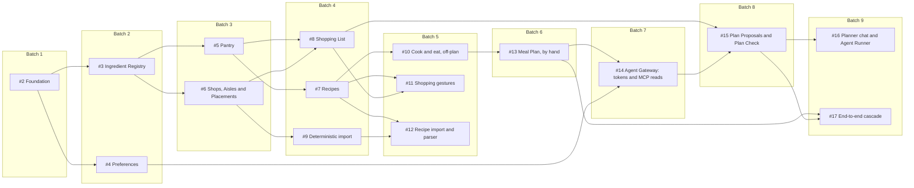

# Larder Core — dependency graph

Parent spec: [#1](https://github.com/tedyeates/larder/issues/1)

Batches are computed from blocking edges: everything in a batch can run in parallel once the
previous batches are closed.

## Critical path

`#2 → #3 → #5 → #7 → #10 → #13 → #14 → #15 → #16`

Nine tickets deep. The length comes from the AI path sitting at the end: the planner can't be built
until there are Meal Slots to propose and a Shopping List to write to, which in turn need Recipes,
which need the Pantry and the Registry.

Both import tickets (#9, #12) sit off the critical path, so the existing 40 recipes and pantry can be
brought across in parallel with feature work rather than blocking it.

The app is genuinely useful well before the end: after `#13` you have manual planning, shopping,
pantry tracking, cooking and portion counting — everything except the AI.
