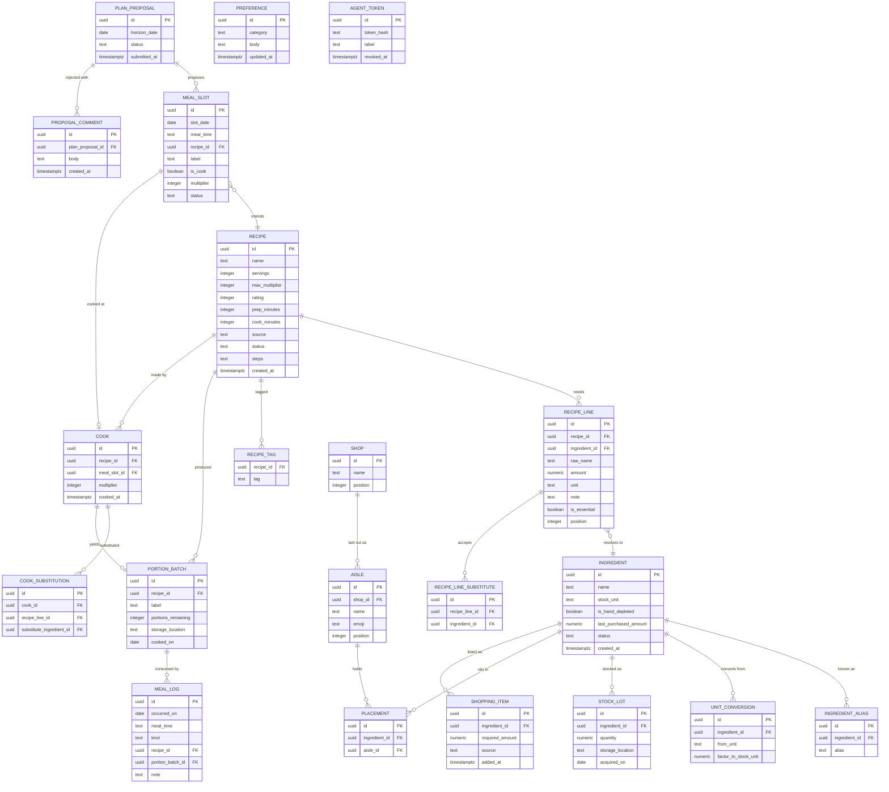
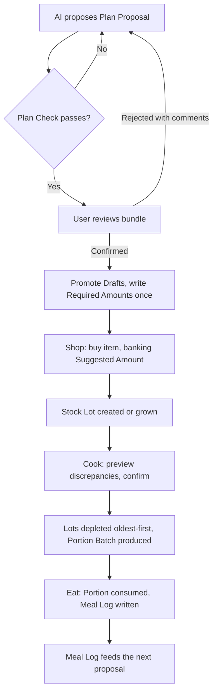
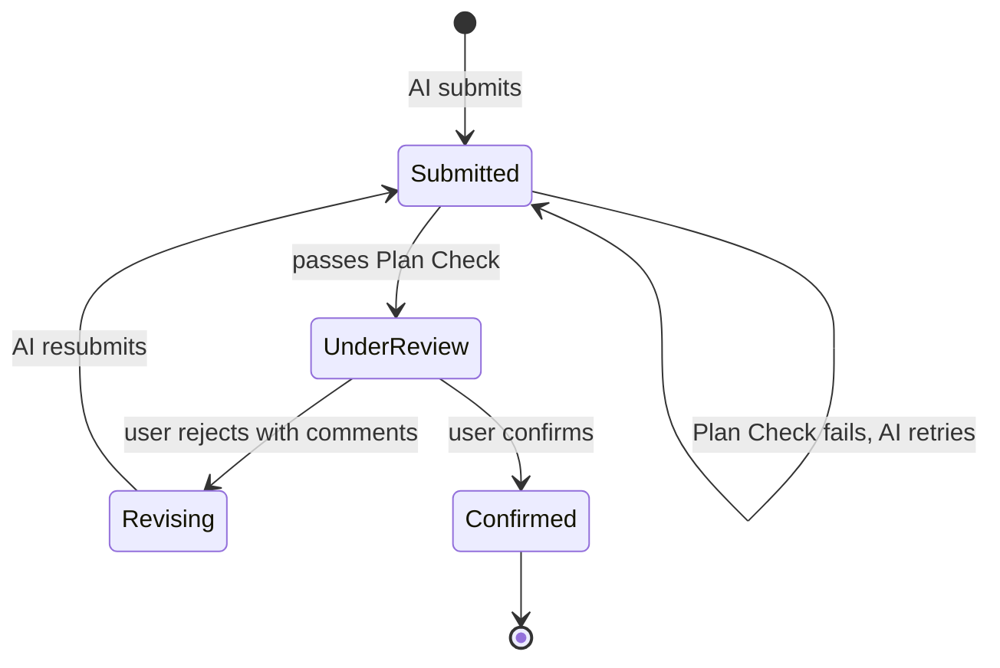
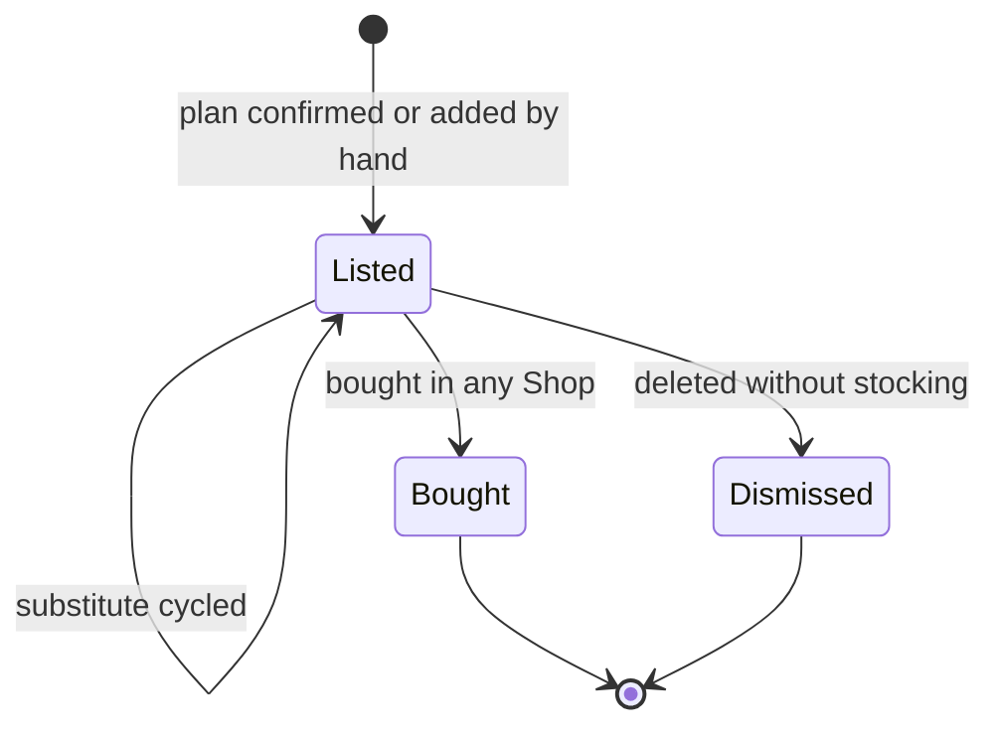

<!-- GitHub: #1 https://github.com/tedyeates/larder/issues/1 -->

# Larder Core

## Problem Statement

Meal planning, shopping and pantry tracking currently live across Obsidian markdown, three TickTick
projects and five AI skills. Truth is split: recipes and plans are markdown, pantry quantities are
encoded in TickTick task titles, and units, aisles and substitutions are prose inside skill files.

Because of that split, nothing can be calculated reliably:

- Recipes name ingredients in free text (`Chicken`, `Leak`, `1 handful beansprouts`) while the
  pantry holds different names in different units (`Chicken thighs — 8 pieces`), so shopping lists
  and depletion are guesswork.
- Nothing counts cooked food. The plan implies leftovers exist; no record says how many, how old, or
  whether they were eaten.
- Breakfast items are free text, so oats, bread, eggs and bananas never deplete despite being the
  most predictable consumption in the system.
- Portion arithmetic is done by the AI in prose and verified by nobody, so a plan can assign more
  meal slots than a recipe can produce.
- Going off-plan breaks everything downstream, because the plan is treated as a record of what
  happened rather than a guide.
- Every action requires a chat session with an AI, including trivial deterministic ones like ticking
  off shopping.

## Solution

A web app owning all of this data in Supabase Postgres, where the AI is confined to the one task
that genuinely needs judgement — proposing a Meal Plan — and everything else is deterministic
arithmetic the user drives directly from phone or desktop.

The state machine:

1. The AI proposes Meal Slots up to a Planning Horizon, along with any new Recipes and Ingredients
   it needs. The user reviews and confirms.
2. Confirming writes Required Amounts to the Shopping List. Once. The plan never writes again.
3. The user buys items in a Shop, sectioned by Aisle. Buying creates or grows a Stock Lot.
4. Cooking depletes Stock Lots oldest-first, with substitution offered where the Pantry falls short,
   and produces a Portion Batch.
5. Eating consumes a Portion and writes a Meal Log entry, which is the only record of what was
   actually eaten and the source of truth for future planning.

Reality diverging from the plan is normal and expected: the plan flags affected Recipes as not
Cookable and offers a Top-Up, but never acts on its own.

## Personas & Roles

Two actors: the user, and the Agent Runner container. The Agent Runner is deliberately restricted —
it can propose but not promote.

| Role | Can view | Can create | Can edit | Can delete | Can confirm | Notes |
|------|----------|-----------|---------|-----------|------------|-------|
| User | Everything | Everything | Everything | Everything | Yes | Single authenticated Supabase user; all deterministic actions available on mobile |
| Agent Runner | Recipes, Ingredients, Pantry, Meal Stock, Meal Log, Preferences, current Meal Slots | Draft Recipes, Draft Ingredients, Plan Proposals, Preference rows | Preference rows, its own Draft records | Nothing | No | Authenticated by Agent Token, never a database credential. Cannot promote Drafts, cannot touch Stock Lots, Portion Batches, Meal Log or the Shopping List |

## User Stories

### Planning

1. As the user, I want to ask the AI to plan meals up to a date, so that I get a plan covering the
   period I care about rather than a fixed calendar week.
2. As the user, I want the AI to read my Preferences before proposing, so that it doesn't suggest
   things I've already told it I dislike.
3. As the user, I want the AI to read my Meal Log, so that it doesn't propose something I ate last
   week.
4. As the user, I want the AI to read my Pantry and Meal Stock, so that it plans around food I
   already have rather than sending me shopping unnecessarily.
5. As the user, I want the AI to see the Meal Slots already planned, so that I can say "keep the
   chicken curry but replan the rest".
6. As the user, I want to discuss the proposal conversationally and have it revised, so that I can
   correct it without editing anything by hand.
7. As the user, I want a Plan Proposal presented as one reviewable bundle — slots, new Recipes, new
   Ingredients, suggested Aliases — so that I can see everything I'm agreeing to at once.
8. As the user, I want structurally broken proposals rejected before I see them, so that I'm never
   reviewing a plan where the portion arithmetic doesn't add up.
9. As the user, I want to reject a proposal with comments and have the AI try again, so that
   rejection is a conversation rather than a dead end.
10. As the user, I want confirming a proposal to promote its Drafts and write the Shopping List in
    one atomic step, so that I never end up with half a plan.
11. As the user, I want Draft records hidden everywhere else in the app, so that unconfirmed AI
    output can't be mistaken for real data.
12. As the user, I want to replan from today at any point, so that a week falling apart on Wednesday
    is recoverable.
13. As the user, I want past Meal Slots frozen, so that the plan stays a guide and history lives in
    the Meal Log.
14. As the user, I want the planner hidden when no Agent Runner is configured, so that the hosted
    deployment degrades cleanly instead of erroring.

### Working the plan

15. As the user, I want to see the current week centred on today, so that opening the app shows me
    what I'm eating now.
16. As the user, I want to rearrange Meal Slots and swap Recipes by hand, so that I'm not dependent
    on the AI for small changes.
17. As the user, I want a Recipe in the plan flagged when its ingredients aren't in the Pantry, so
    that I can see what I can't cook while I'm still in the shop.
18. As the user, I want a line shown as Fulfilled by Substitute when the named Ingredient is absent
    but an acceptable alternative is in stock, so that I don't think I'm blocked when I'm not.
19. As the user, I want a Shortfall flagged when the plan expects more Portions than will exist, so
    that I find out on Tuesday rather than on Thursday at dinner time.
20. As the user, I want a Top-Up button on a flagged Recipe, so that I can push its missing
    Ingredients onto the Shopping List deliberately.
21. As the user, I want to mark a slot as Cooked, so that Portions come into existence.
22. As the user, I want to mark a slot as Eaten, so that a Portion is consumed and the Meal Log
    records it.
23. As the user, I want to mark that I Ate Out instead, so that the Meal Log stays truthful without
    depleting anything.
24. As the user, I want to read the full Recipe from a Meal Slot on my phone, so that I can cook from
    it at the hob.

### Recipes

25. As the user, I want to create and edit Recipes on any device, so that I'm not tied to a desktop
    for something deterministic.
26. As the user, I want Recipe lines to reference canonical Ingredients, so that shopping and
    depletion arithmetic is exact.
27. As the user, I want to state amounts in an Ingredient's Stock Unit, so that no conversion guess
    is ever needed.
28. As the user, I want to attach a human note to a line ("≈ half a bag"), so that the Recipe still
    reads naturally while storing an exact number.
29. As the user, I want to use a Convertible Unit like a cup where a factor exists, so that natural
    cooking measures still work when they can be converted exactly.
30. As the user, I want to omit a quantity entirely for Hand-Depleted Ingredients, so that "splash of
    soy sauce" is legal.
31. As the user, I want Inconsistencies listed on a Recipe, so that I know exactly why it can't be
    planned yet.
32. As the user, I want a Recipe with Inconsistencies blocked from entering a Meal Plan, so that a
    broken recipe can never corrupt a Shopping List.
33. As the user, I want to resolve an unmatched name by mapping it to an existing Ingredient, so that
    the mapping is remembered as an Alias and never asked again.
34. As the user, I want fuzzy-match suggestions when resolving, so that resolution is tapping rather
    than typing.
35. As the user, I want to define per-line Substitutes, so that rice wine can replace mirin in a
    stir-fry but not in sushi.
36. As the user, I want to mark a line Essential, so that no substitution is offered for something
    the dish can't survive without.
37. As the user, I want to rate a Recipe whenever I like, so that ratings reflect experience without
    an AI asking me questions.
38. As the user, I want Allergen Flags shown on Recipes and plans, so that I can spot dairy myself.

### Shopping

39. As the user, I want one Shopping List with a tab per Shop, so that I can shop wherever I happen
    to be.
40. As the user, I want an Ingredient stocked by several Shops to appear in each of their tabs, so
    that I'm not forced into a specific shop.
41. As the user, I want buying an item in one Shop to remove it from all the others, so that I never
    buy it twice.
42. As the user, I want the list sectioned by Aisle rather than merely sorted, so that it matches how
    I walk the shop.
43. As the user, I want tap or swipe-right to bank the Suggested Amount, so that the common case is
    one gesture.
44. As the user, I want swipe-left to offer the Required Amount, a custom amount, and delete without
    stocking, so that exceptions cost one extra tap.
45. As the user, I want swipe up and down to cycle a line through the Recipe's Substitutes, so that I
    can buy rice wine when the mirin is out of stock.
46. As the user, I want buying to create a Stock Lot immediately, so that closing the app mid-shop
    loses nothing.
47. As the user, I want the app to remember what I last bought as the Suggested Amount, so that pack
    sizes are learned rather than fought.
48. As the user, I want to add items by hand, so that kitchen towel and tissues live on the same list.
49. As the user, I want unbought lines to persist, so that a sold-out item is still needed next trip.
50. As the user, I want Items with no Placement shown as Unsorted in every Shop, so that they're
    buyable anywhere and I can assign an Aisle when I spot one.
51. As the user, I want adding an already-listed Ingredient to raise its Required Amount, so that the
    list never shows the same thing twice.

### Pantry and Meal Stock

52. As the user, I want the Pantry grouped by Storage Location, so that it mirrors where things
    physically are.
53. As the user, I want same-day purchases of an Ingredient combined into one Stock Lot, so that the
    Pantry doesn't fill with duplicate rows.
54. As the user, I want different-day purchases kept as separate Lots, so that age is tracked
    honestly.
55. As the user, I want an age badge on Lots and Batches, so that I know the chicken is seven days
    old.
56. As the user, I want depletion to consume the oldest Lot first, so that food gets used before it
    spoils.
57. As the user, I want to adjust Hand-Depleted Ingredients by fraction, so that I can eyeball the
    soy sauce at half empty.
58. As the user, I want to edit or delete any Pantry quantity by hand, so that I can correct drift
    without ceremony.
59. As the user, I want Meal Stock to show how many Portions of each Recipe I have, so that "how many
    meals do I have" has an answer.
60. As the user, I want a bought ready meal recorded as a Portion Batch with no Recipe, so that
    frozen meals are counted like anything else.

### Cooking

61. As the user, I want to cook a Recipe straight from my Recipes, so that going off-plan is a
    first-class action.
62. As the user, I want to see whether a Recipe is Cookable before starting, so that I don't discover
    a missing ingredient halfway through.
63. As the user, I want a warning listing discrepancies before a Cook commits, so that I can confirm
    knowing what the Pantry thinks is missing.
64. As the user, I want to proceed anyway, with short Ingredients floored at zero, so that the app
    never blocks me in my own kitchen.
65. As the user, I want to choose a Substitute at Cook time when the named Ingredient is out, so that
    the right Lot gets depleted.
66. As the user, I want a Cook to produce `servings × multiplier` Portions into the Fridge, so that
    there's no extra prompt to answer.
67. As the user, I want servings and multipliers editable by hand, so that I can correct yield without
    a dedicated flow.
68. As the user, I want Portions of the same Recipe cooked on the same day merged into one Batch, so
    that Meal Stock stays tidy.

### Preferences and configuration

69. As the user, I want Preferences stored as rows the AI reads every session, so that it reasons with
    my leanings without them being enforced.
70. As the user, I want the AI to add and update Preference rows through conversation, so that
    learnings accumulate without me writing them up.
71. As the user, I want to edit and delete Preference rows, so that stale learnings can be pruned.
72. As the user, I want to manage Shops, Aisles, their order and emoji, so that lists match how the
    shops are actually laid out.
73. As the user, I want to attach Ingredients to Aisles per Shop, so that Placements build up as I
    shop.

### Import

74. As the user, I want Ingredients, Stock Units, Shops, Aisles and Placements seeded from my existing
    markdown tables, so that setup is exact rather than retyped.
75. As the user, I want Stock Lots seeded from TickTick with their original creation dates, so that
    ages are real on day one.
76. As the user, I want Meal Log history seeded from Cook Log lines, so that the AI knows what I've
    eaten before its first plan.
77. As the user, I want the AI's proposed import presented for confirmation before anything is
    written, so that I control what enters the canonical tables.
78. As the user, I want imported Recipes with unresolved lines queued for resolution, so that I can
    clear them deliberately.

## Diagrams

### Data model

### The cascade

### Plan Proposal lifecycle

### Shopping Item lifecycle

## Testing Seams

| Seam | Existing/New | Modules it covers | How tests use it |
|------|-------------|-------------------|-----------------|
| Postgres RPCs and views (pgTAP) | New | Inventory, Ingredient Registry, Recipe, Cook, Meal Plan, Shopping, Shops & Placements, Preferences | Seed fixtures, call the RPC, assert resulting table state. Covers FIFO, same-day merge, floor-at-zero, conversion, Plan Check, Cookable, Shortfall, aisle sectioning |
| Recipe Parser function (Vitest) | New | Recipe Parser | Table-driven over the awkward real cases — `Leak`, `Chicken`, `1 handful`, `1/2`, `—`, `2 tbsp` — asserting structured lines and Inconsistencies |
| App HTTP API including MCP routes (Vitest + local Supabase) | New | Agent Gateway | Real HTTP against a real local database. Agent Token auth, rejection of unauthenticated calls, RLS enforcement, tool request/response shapes |
| Agent Runner contract (fake runner) | New | Agent Gateway, planner UI | Stub server implementing accept-message/stream-reply/submit-proposal. Covers revision loop and graceful degradation when absent |
| End-to-end happy path (Playwright) | New | Everything wired together | Real browser → Next → Supabase: confirm a proposal, see the item appear, buy it, assert the Stock Lot, cook, assert Portions, eat, assert the Meal Log |

The e2e seam exists because unit and integration seams mock precisely the boundaries where this
product breaks. The arithmetic is covered by pgTAP; what pgTAP cannot catch is a correct shopping
screen that never calls buy, or a Cook that depletes without producing Portions.

## Implementation Decisions

### Deep modules

**Inventory** (Postgres) is the only module that touches Stock Lots and Portion Batches. It owns FIFO
consumption, same-day lot merging, floor-at-zero clamping and age. Its interface is four operations —
add stock, consume stock, add portions, consume portions — and consume reports what it actually took
against what was requested. Cook builds its discrepancy warning from that report without knowing
what a Lot is.

**Ingredient Registry** (Postgres) owns Ingredients, Aliases, Stock Units, Convertible Units and the
Hand-Depleted flag. Two operations: resolve a name to an Ingredient (returning ranked candidates on
failure), and convert an amount into an Ingredient's Stock Unit (failing loudly when no factor
exists). Every Inconsistency originates here, and no other module performs a conversion.

These two exist so that Cook, Shopping and Plan Check are thin orchestration.

### Other modules

- **Recipe** — recipes, lines, per-line Substitutes, Essential flags, tags, rating. Exposes per-line
  cookability and an Inconsistency list.
- **Recipe Parser** (TypeScript) — the only non-Postgres logic of substance. Markdown in, draft lines
  and Inconsistencies out. Used by import and by hand-paste.
- **Cook** — preview then commit, both from one module so the warning dialog and the write cannot
  disagree. Preview returns per-line availability, proposed substitutions and shortfalls; commit
  depletes, produces the Portion Batch, records substitutions used.
- **Meal Plan** — rolling window of Meal Slots keyed by date and meal time, not weeks. Owns Shortfall
  calculation, proposal submission with Plan Check, and confirmation.
- **Shopping** — add with merge, buy (delegating to Inventory), dismiss, top-up from a Recipe, and the
  per-Shop aisle-sectioned read.
- **Shops & Placements** — shops, ordered aisles carrying an emoji, ingredient placements.
- **Preferences** — flat rows, readable and writable by both actors.
- **Agent Gateway** (Next route handlers) — MCP tool surface, chat relay with streaming, Agent Token
  authentication. Deliberately thin: it validates auth and shape, then calls an RPC.
- **Importer** (TypeScript scripts) — seeds ingredients, units, shops, aisles, placements, stock lots
  with real dates, and Meal Log history.

### State transitions live in Postgres

Per Q12, transitions are `plpgsql` functions called via Supabase RPC, so the UI and the MCP share one
implementation and every multi-table change is atomic. Derived reads — Cookable, Shortfall, the
aisle-sectioned list, Meal Stock totals — are views or TypeScript, not transitions.

### Plan Check

Validation lives inside proposal submission, not in the API layer, and returns structured failures the
AI corrects without user involvement. Checks:

- Portions match slots: for each Recipe, `servings × multiplier` equals the number of Meal Slots
  assigned to it
- Multiplier within the Recipe's stated limit
- Every Recipe Line resolves to an Ingredient with a usable amount
- Every proposed slot is either filled or explicitly empty
- Slots fall within today through the Planning Horizon

Everything else — variety, repetition, cook count, dietary leanings — is a Preference the AI reasons
with and the user rejects conversationally. See ADR references below.

### Agent Runner contract

Accept a message, stream a reply, submit Plan Proposals via MCP. Addressed by configurable URL. The
container holds its own model-provider credentials plus an Agent Token, never a database credential.
When no URL is configured, planning UI is absent and the rest of the app is unaffected.

### Security

- RLS on every table from the first migration; the anon key ships in the browser bundle.
- Service-role key server-side only, never in the browser or the container.
- Agent Tokens stored hashed, revocable, resolved server-side to the owning user.
- The Agent Runner cannot write Stock Lots, Portion Batches, Meal Log entries or Shopping Items, and
  cannot promote a Draft.

### Relevant ADRs

- `0001-meal-plan-writes-once` — the plan writes to the Shopping List once, at confirmation
- `0002-ai-optional-agent-runner` — one codebase, AI behind a configurable runner, mobile does
  everything deterministic
- `0003-recipes-measure-in-stock-units` — recipes measure in Stock Units; unresolvable lines block
  planning

## Testing Decisions

A good test here asserts observable state through one of the five seams and nothing else. For the
Postgres seam that means: seed rows, call the RPC, assert the rows that result — never assert which
internal function ran or in what order.

- **Inventory and Ingredient Registry** get the densest coverage, since every other module's
  correctness depends on them. Cases worth naming: consuming across two Lots of different ages;
  consuming more than exists; same-day merge versus next-day new Lot; conversion with and without a
  factor; Hand-Depleted Ingredients ignored by depletion.
- **Cook** is tested for preview/commit agreement — the discrepancies previewed must equal what
  commit actually clamps.
- **Plan Check** is tested at the pgTAP seam with proposals that fail each rule individually, since
  its whole purpose is precise rejection messages.
- **Shopping** is tested for merge-on-add, cross-shop removal on buy, Suggested Amount learning, and
  Unsorted appearing in every Shop.
- **Recipe Parser** is table-driven against the real awkward cases from the existing 40 recipes.
- **Agent Gateway** is tested for auth failure modes first: no token, revoked token, valid token
  attempting a forbidden write.
- **UI** gets Testing Library coverage only where interaction logic is real — the shopping list's tap,
  swipe-left menu and swipe up/down substitute cycling. Everything else is covered by the e2e path.

Prior art: `transaction-ledger` runs Vitest with `pnpm test` and pgTAP via `npx supabase test db`,
with migrations under `supabase/migrations/` and tests under `supabase/tests/`. The archived `Pantry`
repo used Playwright. Follow both.

## Out of Scope

- Calendar integration
- Photo and URL recipe capture, including OCR
- Hosted AI chat — planning requires the local deployment until a streaming transport exists
- Offline shopping
- Recording what was eaten when eating out, beyond the fact of it
- Discrepancy logging or drift analytics — drift is fixed by editing data directly
- Nutrition, macros, calories
- Cost or budget tracking
- Expiry alerts, as opposed to age badges
- Multi-person planning and sharing
- Writing back to Obsidian or TickTick; import is one-way and one-off
- Pack size inference beyond remembering the last purchased amount

## Further Notes

- Storage Locations carry their own age thresholds for badges: Fridge Portions warn at roughly four
  days, fresh produce at ten, Freezer effectively never. Advisory only, never blocking.
- The Shopping List's aisle emoji comes from the Aisle, not the Ingredient — a deliberate carry-over
  from the current system, which is why Ingredients need no emoji of their own.
- Breakfasts become real Recipes with servings of one, which is what finally makes oats, bread and
  eggs deplete. Roughly four such Recipes cover current habits.
- `Chicken` in existing recipes means "whatever chicken I have". Under per-line Substitutes this
  becomes a concrete Ingredient plus alternatives, resolved during import.
- The archived `tedyeates/Pantry` repo has a committed `.env` in public history. Confirmed to hold no
  credentials, but worth remembering if that history is ever reused.
- Open question deferred to build time: whether the Planning Horizon is stored per proposal or
  configured globally with a default of seven days.
